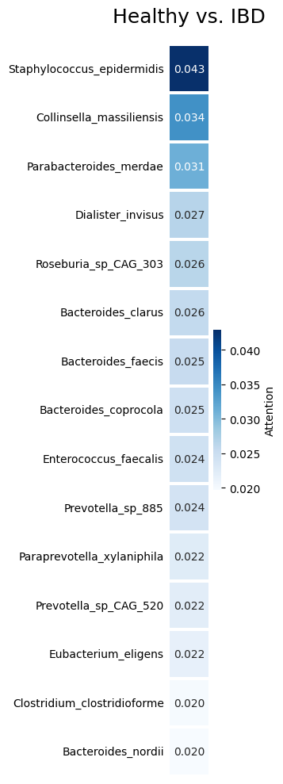
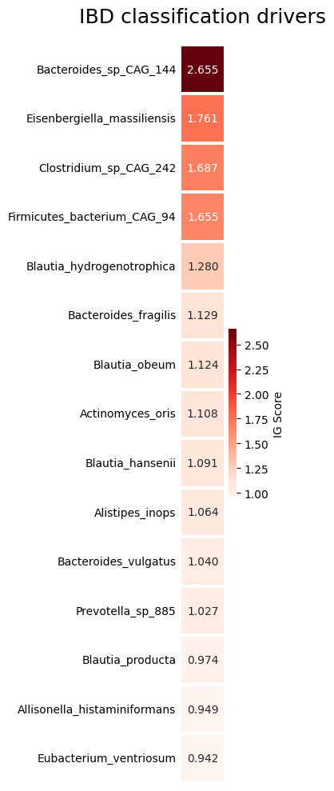
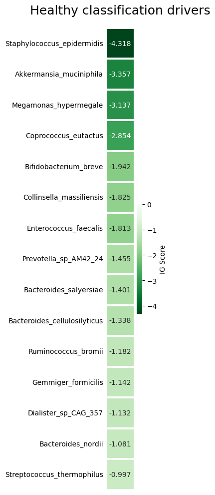

# Beyond Attention: Signed Integrated Gradients Attribution in a BiomeGPT-Style Microbiome Transformer

[](https://arxiv.org/abs/2608.06486) 

## The problem

In a feature-tokenized transformer, each token fuses a fixed identity with a sample-specific measurement. Models like this are usually explained by ranking tokens by `[CLS]` attention weight for a given classification task. That has two limits:

1. **Attention is unsigned.** A large weight shows that the model *uses* a token, not which class that token supports.
2. **Attention comes after fusion.** It can't separate the token's sources from its measured value.

## The model

To study this problem, we re-implemented a [BiomeGPT](https://doi.org/10.64898/2026.01.05.697599)-style model: a BERT-style encoder over microbiome samples. Each of the 1,662 species is a token that combines a species embedding and an abundance embedding:

```
t_i = Embed_ID(s_i) + MLP_AB(a_i)        # T = S + A,  bin 0 = absent
```

The species embedding `S` is the same in every sample; the abundance embedding `A` is what varies between samples. There are no positional encodings. We pretrained the model on about 27K MetaPhlAn stool samples using **masked abundance reconstruction**, then fine-tuned a `[CLS]` head on 4K IBD vs. 4K healthy samples. It reached about 0.93 validation accuracy. That shows the model learned a signal worth explaining; it is not a clinical benchmark.

## Approach: signed IG with a source-derived baseline

We use Integrated Gradients to attribute the decision margin `F = z_IBD − z_Healthy`. Positive scores support IBD and negative scores support healthy.

A naive all-zero baseline erases the species identity as well as the abundance. We instead derive the baseline from the token's own sources:

```
T′ = S + A₀,   A₀ = MLP_AB(0)      →      T − T′ = A − A₀
```

The species identity stays fixed along the whole integration path, and only the abundance moves from zero to its observed value. So `IG_S = 0` by construction, while `S` still conditions every gradient. With additive fusion, IG on the fused token with this baseline equals abundance IG. The same construction carries over to tabular feature-tokenized transformers that add an identity embedding to a value embedding. In preliminary runs it also gave much smaller convergence deltas than the all-zero baseline.

```python
_, A0 = model.backbone.build_source_embeddings(species_ids, torch.zeros_like(abundance_bins))
ig.attribute(inputs=(S, A), baselines=(S.clone(), A0), ...)   # forward returns z_IBD − z_Healthy
```

The full implementation is in [`attribution/IG.py`](src/token_source_attributor/attribution/IG.py).

## Results (7,382 samples)

- **Signs line up with the labels.** Mean attribution is positive for true positives (0.0027) and negative for true negatives (−0.0045).
- **Absent species.** Zero-abundance tokens still get some attention, but their IG is exactly zero.
- **Heavy attention is not IBD evidence.** The two most-attended species, *S. epidermidis* and *C. massiliensis*, both support the healthy class. Of the top 15 attended species, 4 are among the top 15 health drivers and only 1 among the top 15 IBD drivers.
- **Sensitivity diagnostics.** The path-averaged gradient `G_A` shows which low-abundance species the model is most sensitive to. These are diagnostics, not attributions.
- **Response profiles.** How attribution varies with abundance is often non-monotonic and depends on context.

| `[CLS]` attention | IG: IBD drivers | IG: health drivers |
|---|---|---|
|  |  |  |

## Limitations

The results don't show clinical generalization or causality. Each IG score is net evidence along the integration path, so effects of opposite sign can cancel. This work is first-order only. We recommend Integrated Hessians to study interactions between species.

## Usage

Set up the environment:

```bash
python3 -m venv .venv && source .venv/bin/activate
pip install -e ".[dev]"
pip install torch torchvision torchaudio --index-url https://download.pytorch.org/whl/cu126
```

The binned data ships in `src/token_source_attributor/data/`. To rebuild it, run the R scripts and then `data_preprocessing.py`. Pretrain the model:

```bash
python -m token_source_attributor.training.pretrain_biomgpt
```

Fine-tune the classifier:

```bash
python -m token_source_attributor.training.classifier_biomgpt
```

Run IG:

```bash
pytest tests/test_IG.py -s
```

Then open `visualizations.ipynb` to make the figures.

## Citation

```bibtex
@article{nelson2026beyondattention,
  title   = {Beyond Attention: Signed Integrated Gradients Attribution in a BiomeGPT-Style Microbiome Transformer},
  author  = {Nelson, Oren},
  journal = {arXiv preprint arXiv:2608.06486},
  year    = {2026}
}
```

## License

See [LICENSE](LICENSE).
